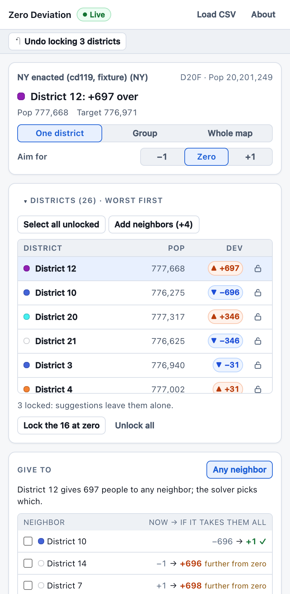
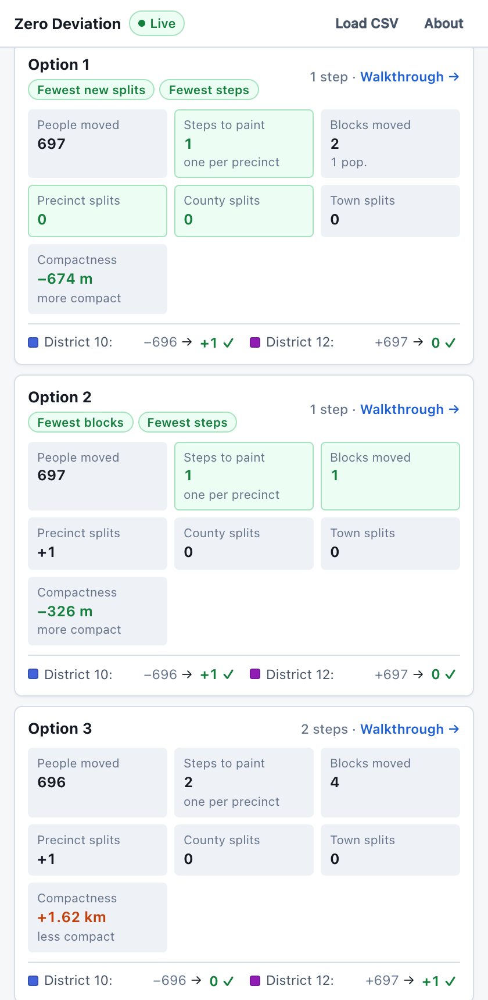
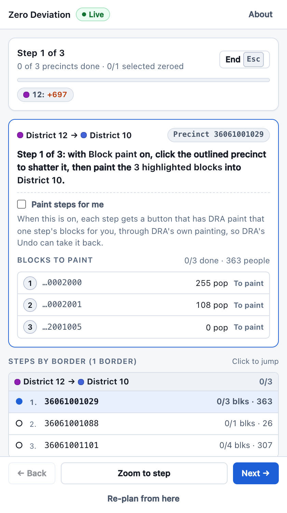
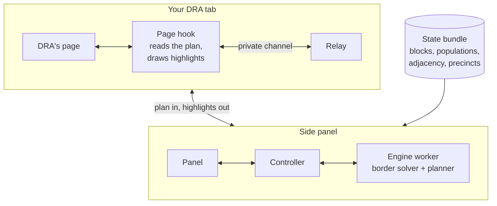

<p align="center">
  
</p>

<p align="center">
  <b>A browser extension for <a href="https://davesredistricting.org">Dave's Redistricting</a> that finds the census blocks to move so your districts land on exactly the target population, then walks you through painting them.</b>
</p>

---

Getting the last few people out of a district means hunting along its border for blocks that add up to exactly the right number, without cutting anything off or splitting a precinct you didn't need to. Zero Deviation does the hunting. It reads the map you have open, works out the moves inside your browser, and shows them on DRA's own map, numbered, one precinct at a time.

<table>
  <tr>
    <td width="33%" valign="top">
      <picture>
        <source media="(prefers-color-scheme: dark)" srcset="docs/readme/panel-districts-dark.png">
        
      </picture>
    </td>
    <td width="33%" valign="top">
      <picture>
        <source media="(prefers-color-scheme: dark)" srcset="docs/readme/panel-options-dark.png">
        
      </picture>
    </td>
    <td width="33%" valign="top">
      <picture>
        <source media="(prefers-color-scheme: dark)" srcset="docs/readme/panel-walk-dark.png">
        
      </picture>
    </td>
  </tr>
  <tr>
    <td valign="top"><b>Pick what to fix.</b> One district, a group, or the whole map. Lock the districts that are finished.</td>
    <td valign="top"><b>Compare the options.</b> Each one says what it costs before you start: steps, splits, compactness.</td>
    <td valign="top"><b>Paint it.</b> Blocks are numbered on the map and tick off as you paint them.</td>
  </tr>
</table>

<sub>Screenshots: New York's enacted congressional plan with three precincts moved to create deviations, run against the project's stand-in for the DRA page.</sub>

## What it does

| Mode | What you get |
|---|---|
| **One&nbsp;district** | Ranked ways to bring it to zero by trading with its neighbors. You can choose which neighbor gives or takes. |
| **Group** | A plan that zeroes the districts you tick, among themselves or with outside neighbors absorbing the difference. |
| **Whole&nbsp;map** | A plan for every unlocked district at once, border by border. |

Pick an option and the walkthrough takes over. Each step is one precinct: shatter it, paint the numbered blocks, commit. The panel watches the map and ticks blocks off as they land, notices edits that aren't part of the plan, and can re-plan from wherever you are. At the end it re-reads DRA's own numbers and confirms every district.

If you'd rather not click each block, an optional setting adds a button that paints the current step through DRA's own paint actions, so DRA's Undo takes it back. It is off by default and paints one step per click.

## What every suggestion keeps to

- **Zero means zero.** Every district ends at the exact target, or one person above it when the state's population doesn't divide evenly.
- **Districts stay in one piece.** A move is rejected if it would cut either district into more pieces than it has now.
- **Land first.** Two districts that touch on land never trade across water. Water crossings are used only where water is the only connection, and the option says so.
- **Compact bites, not tendrils.** Moved blocks stay within four blocks of the receiving district. Chains of empty blocks reaching for distant population are not offered. If nothing compact can hit the number, the option is marked as a long reach.
- **Whole precincts where possible.** Splitting a precinct, a county or a town costs more than moving one whole, and each option shows its count of new splits.
- **Small numbers still work.** When a border can't move exactly 3 people one way, the planner trades both ways across it, for example 7 one way and 4 back.
- **Locked districts are left alone.** No suggestion moves a block into or out of a district you locked.
- **Your map stays yours.** Nothing changes unless you paint it, or click the paint button you turned on.

## How it works



- **The page hook** reads the open plan from the page, including edits you haven't committed, and draws the highlight layers on DRA's map. It makes no network requests and never calls DRA's servers.
- **The state bundle** is a compact file per state built from Census TIGER block shapes and DRA's published block data: every block's population, county, precinct, town, whether it is water, and which blocks share a border and for how many meters.
- **The engine** solves one border at a time: which contiguous set of blocks moves exactly N people at the lowest cost. **The planner** sits above it for several districts: it routes people across borders with a min-cost flow, asks the engine to realize each border, and repairs what doesn't fit with two-way trades and detours through other districts. Every plan is checked by a separate verifier before it is shown.

All of the solving runs in a Web Worker in your browser. On New York (288,819 blocks, 26 districts) a one-district solve takes a fraction of a second and a whole-map plan one to a few seconds.

## Build it

It is not in an extension store yet, so for now you build it yourself. You need Node, [uv](https://docs.astral.sh/uv/) for the data pipeline, and a Chromium browser with a side panel (Chrome 114 or later).

```bash
git clone https://github.com/jetpackrider/district-zeroing-extension.git
cd district-zeroing-extension
npm run install:all

# Data for the state you draw. New York downloads about 340 MB and builds a 31 MB bundle.
(cd pipeline && uv run build.py build NY)

# The panel UI, then an unpacked extension with that state's data inside it.
npm run build --prefix packages/panel-ui
ZD_LOCAL_STATES=NY npm run build:local --prefix apps/extension
```

Then:

1. Open `chrome://extensions`, turn on **Developer mode**, click **Load unpacked** and pick `apps/extension/local/chrome-mv3`.
2. Open one of your maps on davesredistricting.org and **reload the tab** once, so the page hook attaches.
3. Click the extension's toolbar button to open the panel.

For several states, list them: `ZD_LOCAL_STATES=NY,NJ,PA`. The first time you try the paint button, do it on a copy of a map.

## Status

This is a working pre-release, and it helps to know exactly how far it has been tested.

- **Tested by machine:** about 200 unit tests and 69 browser tests. The browser tests drive the real extension against a stand-in for the DRA page, including New York's enacted congressional plan on the real New York data.
- **Data:** bundles for all 50 states and DC build and pass validation against DRA's published populations and precinct graph.
- **On the live site:** used by hand on New York maps. The paint button is the least-tested part there.
- **Supported maps:** 2020 census shapes, single-member districts, equal population, whole-state maps. Anything else gets a clear message and no suggestions.
- **Known gaps:** a 203-district map (Pennsylvania's House) is not solved as a whole map; solve it in groups. Whole-map plans for California and Texas took 16 to 24 seconds when last measured.
- **It leans on DRA's page internals,** which are not a supported interface. When DRA changes them, a startup self-check says which part broke, and you can still drop in DRA's block-assignment CSV export and work from that.

Zero Deviation is not affiliated with or endorsed by Dave's Redistricting. What needs settling before a store release, including checking with the DRA team, is in [docs/PUBLISHING.md](docs/PUBLISHING.md).

## Privacy

Your plan never leaves your browser. The extension has no analytics, no accounts and no server of its own. The build described above makes no network requests at all, because the data is inside it. A store build would download the public per-state data file for the state you open, and nothing about your map.

## Around the repository

| Path | What's there |
|---|---|
| [`apps/extension`](apps/extension) | The extension: page hook, relay, side panel, engine worker, browser tests |
| [`packages/engine`](packages/engine) | One border, one district: the block solver and its verifier |
| [`packages/planner`](packages/planner) | Several districts: flow, two-way trades, repair, plan verifier |
| [`packages/panel-ui`](packages/panel-ui) | The panel as a React component, with a mock controller for development |
| [`packages/bundle`](packages/bundle) | Reader for the per-state data bundle |
| [`packages/contracts`](packages/contracts) | The types everything above agrees on |
| [`pipeline`](pipeline) | Census and DRA data in, validated state bundles out |
| [`docs`](docs) | [Bundle format](docs/BUNDLE_FORMAT.md), [publishing notes](docs/PUBLISHING.md) |
| [`SPEC.md`](SPEC.md), [`RECON.md`](RECON.md) | The original build spec, and notes on how DRA's page works |

Run everything with `npm run test:all` (the browser tests need `npx playwright install chromium` once, inside `apps/extension`). `SCREENS=1 npx playwright test zz-screens` in `apps/extension` regenerates the screenshots above, and `python3 docs/readme/make-hero.py` the banner.

## Data and credit

Block populations and precinct assignments are adapted from [Dave's Redistricting](https://github.com/dra2020) data, shared under CC BY-SA 4.0; bundles built from it carry the same license. Block shapes and census counts are from the U.S. Census Bureau and are in the public domain.
